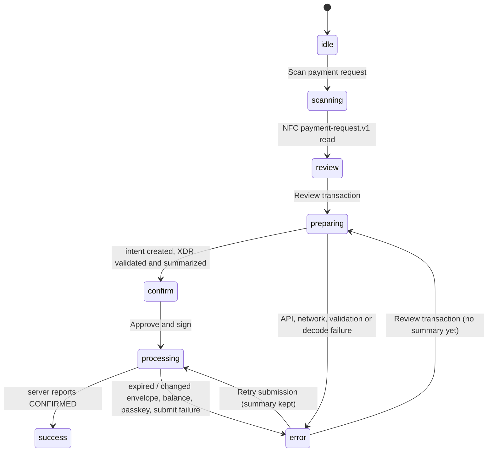

# Send Payment Flow: Pre-signing Summary

The payer side of a Vela payment is driven by `SendHomeView`. Before any
passkey prompt or local signing happens, the payer sees a summary decoded from
the **unsigned transaction envelope returned by the server**, not from the NFC
request. That way the screen shows what the wallet key will actually sign.

## 1. Steps

1. **Review** – the scanned request (amount, asset, recipient, memo) is shown.
2. **Prepare** (`Review transaction`) – the client creates or reuses the payment
   intent, checks the intent network, runs
   `AccountService.validatePaymentTransaction` against the intent, then decodes
   the envelope with `buildPaymentTransactionSummary`. No passkey, no signing.
3. **Confirm** – `TransactionSummaryCard` lists:
   - amount and asset code (plus issuer for non-native assets),
   - destination and source (your wallet) addresses,
   - memo, including non-text memo types, which are labelled rather than hidden,
   - maximum network fee in XLM and stroops,
   - network, upper time bound ("Valid until"), sequence number and transaction hash.
4. **Approve and sign** – trustline and balance checks, passkey authorization,
   local signing and server submission run as before. Before the passkey prompt
   and again immediately before signing, `assertSigningMatchesSummary`
   re-decodes the intent envelope and blocks signing if its hash differs from
   the reviewed one or its upper time bound has passed.

## 2. Files

| File | Responsibility |
| --- | --- |
| `src/features/send/services/paymentTransactionSummary.ts` | Decodes the unsigned XDR into a summary, converts fees without floating point, checks expiry and review/sign hash equality |
| `src/features/send/components/TransactionSummaryCard.tsx` | Presentational card for the summary; owns no actions |
| `src/features/send/views/SendHomeView.tsx` | Splits the flow into prepare (summary) and approve (authorize, sign, submit) |
| `src/features/send/services/paymentTransactionSummary.test.ts` | Deterministic tests using in-memory testnet envelopes and random keypairs |

## 3. Error boundaries

| Condition | Where | Message |
| --- | --- | --- |
| Intent has no unsigned XDR | prepare | `Payment intent is missing its unsigned transaction.` |
| Fee-bump envelope | prepare | `Fee-bump payment envelopes are not supported.` |
| More than one operation / non-payment | prepare | Rejected before a summary is shown |
| Unknown network passphrase | prepare | `Unsupported Stellar network passphrase.` |
| Envelope differs from the reviewed one | approve | `The transaction changed after review. Scan the request again.` |
| Envelope past its upper time bound | approve | `This transaction expired before it was signed. Scan a new request.` |

## 4. Compatibility and rollout

- No server contract changes. The summary reads only the existing
  `PaymentResponse.unsignedXdr` field; coordination with
  [vela-server](https://github.com/VelaPayments/vela-server) is not required.
- The only user-visible change is an extra tap: `Review transaction` →
  `Approve and sign` replaces the single `Approve and pay` button.
- The fee shown is the envelope's **maximum** fee. The fee actually charged by
  the network can be lower and is not known until the transaction is applied.
- "Valid until" is rendered in the device's local time zone.

## 5. Limitations

- Covered by unit tests only. The summary UI has not yet been validated on a
  physical NFC device pair or with a live testnet payment; follow
  [testnet-demo.md](testnet-demo.md) for that, using testnet accounts only.
- Nothing in the summary is secret, but the flow intentionally does not log the
  unsigned or signed XDR, the transaction hash, or account addresses.
